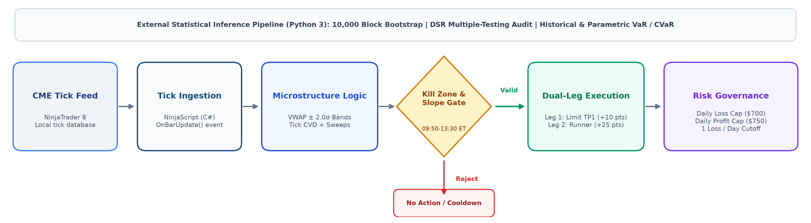
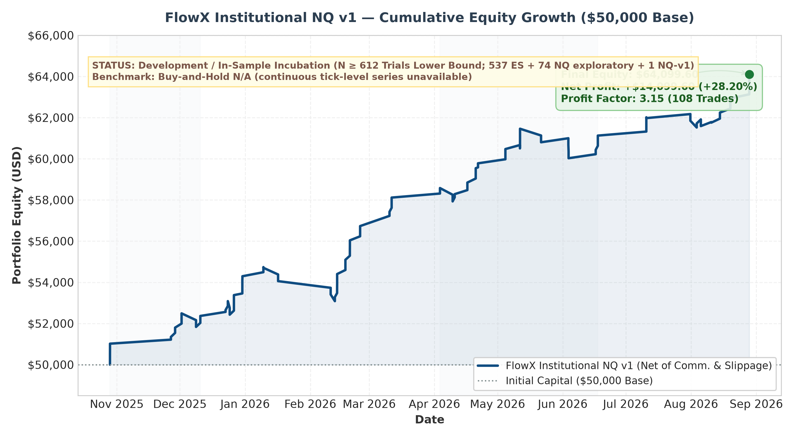
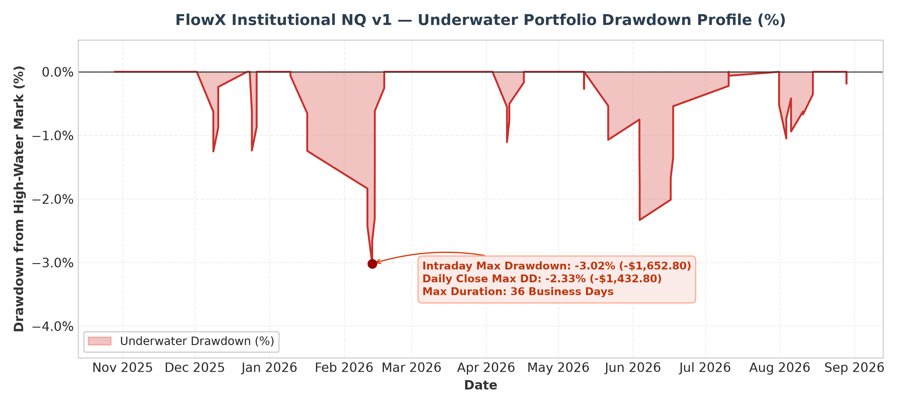
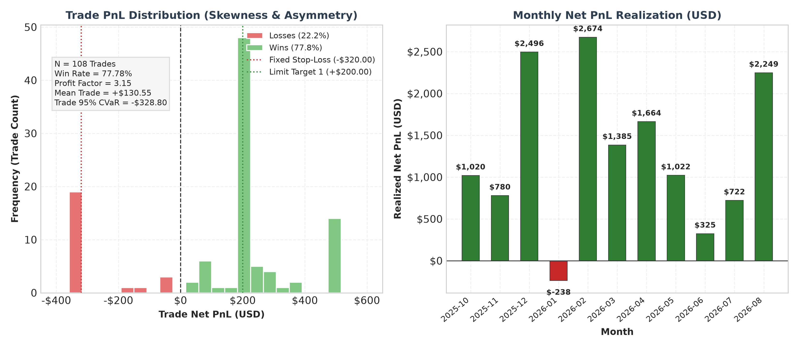
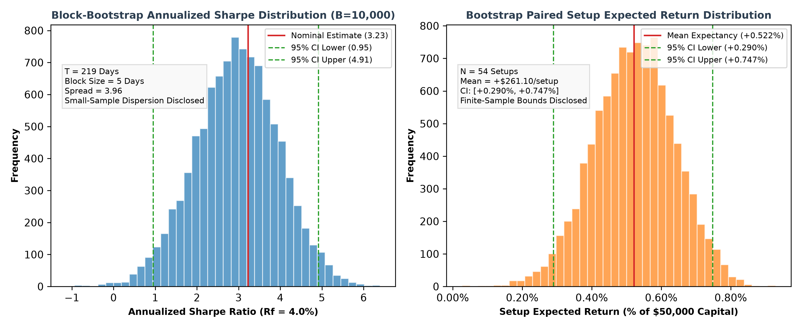

# Quantitative Trading & Algorithmic Backtesting Portfolio
**Joint Research Dossier (ESE Oran)**  
**Target Programs:** MSc in Quantitative Finance / Data Science for Finance (UNIVPM Ancona, UNIPG Perugia, UNICAL Calabria, UNISI Siena; 2027/2028 Intake)

* **Yasser REZKI** (Data Science for Economics & Business)
* **Ramy Ihab HENNANE** (Economics, Finance & Markets)
* **Code Repository & Research Artifacts:** `[Insert GitHub Repository URL / Private Research Release Available Upon Request]`

---

### 1. Executive Summary & System Architecture

This research dossier presents an empirical algorithmic framework developed alongside academic studies at ESE Oran. The project investigates intraday order flow imbalances and mean-reversion dynamics on index futures contracts.

Standard backtesting environments often rely on simplified bar-close execution assumptions that underestimate real-world friction. To address execution realism, the strategy is implemented in NinjaScript (C#) and executed on the NinjaTrader 8 tick-replay engine, coupled with an external Python statistical audit pipeline. The framework incorporates explicit transaction friction models (exchange fees and execution slippage) alongside intraday risk constraints (a daily loss cap, a daily profit cap, and a single-loss-per-day restriction).

---

### 2. Quantitative Strategy: FlowX Institutional NQ v1

#### 2.1 Economic Hypothesis & Mathematical Formulation

* **Asset Class & Market Universe:** CME E-mini Nasdaq-100 index futures (`NQ`), evaluating four quarterly contracts (`NQ DEC25`, `NQ MAR26`, `NQ JUN26`, `NQ SEP26`) across 219 business days (48,399 one-minute bars within the 09:50–13:30 ET window) with tick-level price resolution.
* **Economic Premise:** In equity index futures, large liquidity demand shocks that push prices beyond statistical volatility envelopes can temporarily deplete limit order book depth (Kyle, 1985; Hasbrouck, 2007). When aggressive market orders fail to generate further price displacement (indicated by trade delta exhaustion and price rejection wicks), quotes tend to revert toward the volume-weighted intraday mean.
* **Mathematical & Econometric Formulation:**
  1. **Intraday Session-Anchored VWAP & Volatility Bands:**
     At each intraday bar \(t\), the benchmark price \(VWAP_t\) and conditional standard deviation \(\sigma_t\) are computed recursively from continuous trade price \(P_i\) and volume \(V_i\):
     $$VWAP_t = \frac{\sum_{i=1}^t P_i V_i}{\sum_{i=1}^t V_i}, \quad \sigma_t = \sqrt{\frac{\sum_{i=1}^t P_i^2 V_i}{\sum_{i=1}^t V_i} - VWAP_t^2}$$
     Mean-reversion entry thresholds are placed at \(VWAP_t \pm 2.0\sigma_t\) (`VwapDevBand2 = 2.00`).
  2. **Order Flow Delta & Lee-Ready Microstructure Filter:**
     Because historical Level 1 tick feeds lack continuous National Best Bid and Offer (NBBO) quotes, trade direction is classified via the tick test (tick rule) subset of the Lee & Ready (1991) microstructure framework:
     $$D_k = \begin{cases} +1 & \text{if } P_k > P_{k-1} \\\\ -1 & \text{if } P_k < P_{k-1} \\\\ D_{k-1} & \text{if } P_k = P_{k-1} \end{cases}$$
     with \(D_0 = +1\). Intra-bar delta is accumulated continuously (\(\Delta_{\text{bar}} = \sum_{k \in \text{bar}} D_k V_k\)), tracking net aggressive order flow without continuous quote references.
  3. **Adaptive Institutional Sweep Detection:**
     An aggressive institutional sweep threshold is dynamically calculated from bar volume:
     $$\text{Sweep Threshold} = \max\left(20, 0.08 \times \text{SMA}_{20}(V_{\text{bar}})\right)$$
     where \(\text{SMA}_{20}(V_{\text{bar}})\) is the 20-period simple moving average of 1-minute bar volume (combining an absolute floor of 20 contracts with an adaptive 8% ratio of average bar volume). In the tick-replay engine, an institutional sweep flag is triggered if single tick volume, accumulated consecutive same-direction sweep volume, or intra-bar delta meets or exceeds this threshold: \(\max\left(V_{\text{tick}}, V_{\text{consecutive\_sweep}}, |\Delta_{\text{bar}}|\right) \ge \text{Sweep Threshold}\).
  4. **Absorption Signature:**
     A trade setup requires price penetration beyond \(2.0\sigma_t\), a rejection wick of at least 3.0 NQ points, and trade delta exhaustion (absorption of aggressive market orders without price continuation).
  5. **Macro Trend Slope Filter:**
     To reduce counter-trend entries during directional trend regimes, the linear regression slope of VWAP over a 20-bar window is bounded: \(|\text{Slope}_{20}(VWAP)| \le 4.00\) points.
   6. **Temporal Execution Window (New York Morning Session):**
      Trading is strictly restricted to 09:50 to 13:30 Eastern Time (ET) via dynamic time conversion in code (`barTimeNy = ToEasternTime(Time[0])`), avoiding the opening 20 minutes of cash open volatility and late-afternoon illiquidity. All trades execute within this invariant 09:50–13:30 ET CME market window across all 41 active trading sessions (spanning 19 sessions during Eastern Standard Time and 22 sessions during Eastern Daylight Time). Cumulative VWAP and prior-day Volume Profile anchor to the CME daily settlement and session rollover at 17:00 Central Time (18:00 Eastern Time).

#### 2.2 Execution Assumptions & Friction Modeling

The backtesting configuration applies the following execution and friction parameters:

* **Broker Commission:** $3.80 per round-trip per contract ($1.90 per side). Over the 108 executed trade legs, total deducted commission was $410.40.
* **Exchange Slippage:** Modeled as 1 tick ($5.00 per contract on NQ) on all market entry and stop-loss orders (`Slippage = 1`).
* **Limit Order Execution:** Profit target orders (Leg 1) are submitted as native exchange limit orders (`SetProfitTarget`). The backtesting engine assumes execution at the exact limit price without price improvement (`IsFillLimitOnTouch = false`).

#### 2.3 Methodological Disclosures & Statistical Inference

* **Sample Nature:** The 4-quarter test window (2025-10-28 to 2026-08-28) is a **development / in-sample incubation dataset**. Parameters were observed and calibrated across this period.
* **Sample Size Caveat:** Across the 10-month evaluation period, 54 paired setups (108 trade legs) occurred. With 54 setups, statistical point estimates are subject to sampling variability.
* **Bootstrap Confidence Intervals (\(B = 10,000\) iterations, seed 42):**
  * **Paired Setup Win Rate (\(N = 54\)):** 77.78%, 95% bootstrap CI = **[66.67%, 88.89%]**.
  * **Setup Expected Return:** +0.522% of initial capital (+$261.10/setup), 95% bootstrap CI = **[+0.290%, +0.747%]** ([+$144.80, +$373.70]).
  * **Trade Leg Win Rate (\(N = 108\)):** 77.78% (point estimate; confidence interval omitted as legs of the same setup are not independent).
  * **Annualized Sharpe Ratio (\(R_f = 4.0\%\)):** Point estimate = 3.23 (accounting for Sharpe estimation uncertainty; Lo, 2002).
    * 95% IID Bootstrap CI: **[1.28, 5.06]**
    * 95% Moving Block Bootstrap CI (block length = 5 days): **[0.95, 4.91]**
* **Multiple Testing Correction & Deflated Sharpe Ratio (DSR):**
  When trading strategies are developed through iterative exploratory tests, nominal performance metrics are subject to selection bias (White, 2000; Bailey & López de Prado, 2014; Harvey, Liu & Zhu, 2016). The research trial registry records at least 612 trials (lower bound \(N \ge 612\); informal iterations not counted; 537 on ES, 74 exploratory on NQ, and 1 pre-registered NQ-v1 variant). The expected maximum Sharpe ratio under the null hypothesis of zero skill (\(SR^*\)) and the resulting Deflated Sharpe Ratio (DSR) depend on the unobserved cross-trial standard deviation (\(\sigma_{SR}\)):

| Number of Trials (\(N\)) | Cross-Trial Dispersion (\(\sigma_{SR}\)) | Expected Max Sharpe (\(SR^*\)) | Asymptotic \(Z\)-Score | Deflated Sharpe Ratio (DSR) |
| :---: | :---: | :---: | :---: | :---: |
| 74 (NQ exploratory trials) | 0.50 | 1.21 | 2.12 | 0.9831 |
| 74 (NQ exploratory trials) | 1.00 | 2.42 | 0.85 | 0.8017 |
| 74 (NQ exploratory trials) | 1.50 | 3.63 | -0.43 | 0.3349 |
| 74 (NQ exploratory trials) | 2.00 | 4.85 | -1.70 | 0.0445 |
| 300 (illustrative intermediate case) | 0.50 | 1.45 | 1.87 | 0.9695 |
| 300 (illustrative intermediate case) | 1.00 | 2.90 | 0.35 | 0.6370 |
| 300 (illustrative intermediate case) | 1.50 | 4.34 | -1.17 | 0.1206 |
| 300 (illustrative intermediate case) | 2.00 | 5.79 | -2.70 | 0.0035 |
| **612 (Full Registry Bound)** | **0.50** | **1.56** | **1.76** | **0.9607** |
| **612 (Full Registry Bound)** | **1.00** | **3.11** | **0.12** | **0.5486** |
| **612 (Full Registry Bound)** | **1.50** | **4.67** | **-1.52** | **0.0649** |
| **612 (Full Registry Bound)** | **2.00** | **6.23** | **-3.15** | **0.0008** |

*Registry Decomposition & Asymptotic Z-Score Formulation:* The 612-trial registry = 537 ES + 74 exploratory NQ + 1 pre-registered NQ-v1 variant. The asymptotic Z-score denominator is computed using the analytical standard error of the Sharpe ratio adjusted for daily return skewness (\(\gamma_3\)) and kurtosis (\(\gamma_4\)) over \(T = 219\) business days (Mertens, 2002; Bailey & López de Prado, 2014), rather than bootstrap standard errors.

*Interpretation:* The parameter \(\sigma_{SR}\) cannot be directly observed from historical outputs, so the values above represent sensitivity benchmarks. For \(N \ge 612\), if trial dispersion is assumed to be \(\sigma_{SR} = 0.50\), the DSR is 0.9607. If trial dispersion is \(\sigma_{SR} = 1.00\) or higher, the DSR decreases to 0.5486 or lower. This sensitivity demonstrates that statistical confidence depends on the trial variance across the exploratory search space, confirming that the nominal Sharpe ratio of 3.23 cannot be confirmed without independent out-of-sample testing.

#### 2.4 Empirical Performance & Tail-Risk Metrics

Performance figures are reported as percentages of the $50,000.00 initial notional capital, with the exception of Maximum Drawdown metrics (-3.02% intraday peak, -2.33% daily close), which are calculated as percentage declines from the running equity peak (high-water mark). The Calmar ratio of 11.52 (\(34.78\% / 3.02\%\)) is consistently defined relative to this peak-equity maximum drawdown:

| Performance Metric | FlowX Institutional NQ v1 (Net of Fees & Slippage)§ |
| :--- | :---: |
| **Cumulative Return (%)** | **+28.20%** (+$14,099.60) |
| **Annualized Return (CAGR %)\*** | **+34.78%** (\(T = 0.832\) years) |
| **Annualized Volatility (%)\*** | **8.81%** (Daily \(\sigma = 0.555\% \times \sqrt{252}\)) |
| **Sharpe Ratio (\(R_f = 4.0\%\))** | **3.23** [Block Bootstrap 95% CI: 0.95, 4.91] |
| **Sharpe Ratio (\(R_f = 0.0\%\))** | **3.68** (Zero risk-free comparison) |
| **Sortino Ratio (Target = 0.0%)**| **8.42** (Downside deviation metric) |
| **Calmar Ratio (CAGR / Max DD)†** | **11.52** (\(34.78\% / 3.02\%\)) |
| **Maximum Drawdown (Intraday Peak)†** | **-3.02%** (-$1,652.80 on 2026-02-12) |
| **Maximum Drawdown (Daily Close)†**| **-2.33%** (-$1,432.80 on 2026-06-03) |
| **Max Drawdown Duration** | **36 business days** (2026-05-18 to 2026-07-08) |
| **Paired Setups Executed** | **54 setups** (42 Wins, 12 Losses) |
| **Total Executed Trade Legs** | **108 trades** (84 Wins, 24 Losses) |
| **Setup Win Rate (%)** | **77.78%** [Bootstrap 95% CI: 66.67%, 88.89%] |
| **Profit Factor (Gross Win / Gross Loss)** | **3.15** ($20,670.80 / $6,571.20) |
| **Daily 95% Parametric VaR (All Days)** | **-0.78%** (-$392.09) |
| **Daily 95% Historical VaR (All 219 Days)‡**| **-0.03%** (-$12.76) |
| **Daily 95% Historical CVaR (All 219 Days)** | **-0.95%** (-$473.29) |
| **Daily 95% Parametric VaR (Active 41 Days)** | **-1.18%** (-$588.33) |
| **Daily 95% Historical VaR (Active 41 Days)‡**| **-1.32%** (-$657.60) |
| **Daily 95% Historical CVaR (Active 41 Days)**| **-1.37%** (-$687.00) |

*\* Note on Annualization:* Annualized figures are computed using the calendar duration \(T = 304 / 365.25 = 0.832\) years (2025-10-28 to 2026-08-28; 219 business days). CAGR and annualized volatility represent mathematical extrapolations of this 10-month window, not long-term historical returns.  
*† Note on Drawdown & Calmar Ratio:* Maximum drawdown figures are computed as percentage losses from the running peak equity (\(\text{DD}_t = (E_t - \text{Peak}_t) / \text{Peak}_t\)), rather than nominal capital, reaching -3.02% intraday peak (-$1,652.80 from a $54,785.40 high-water mark on 2026-02-12) and -2.33% at daily close (-$1,432.80 from a $61,544.80 high-water mark on 2026-06-03). The Calmar ratio (\(\text{CAGR} / |\text{Max DD}| = 34.78\% / 3.02\% = 11.52\)) is strictly defined and mathematically consistent with this peak-equity drawdown formulation.  
*‡ Note on VaR Artifact:* The historical 95% VaR across all 219 days (-0.03%) is an artifact of execution frequency, as 178 of the 219 business days (81.3%) had zero trades. The 5th percentile of the full distribution falls near the boundary of zero-return days, compressing the metric. On active trading days (\(N = 41\)), the historical 95% VaR is -1.32% (-$657.60), reflecting downside risk during active market exposure.  
*§ Note on Benchmark:* The backtest operated on discrete quarterly futures contracts without a rollover-adjusted continuous series; consequently, no passive benchmark comparison is reported.

---

### 3. Risk Constraints & Execution Governance Module

The execution model combines order-level bracket rules with session-level risk constraints:

* **Dual-Leg Split Execution & Ratchet Stops:**  
  Each market entry executes a 2-contract bracket managed independently:
    * **Leg 1 (Limit Scalp TP1):** Targets +10 points (+40 ticks = +$200 per contract) via a limit order. When TP1 fills, the Leg 2 stop is adjusted to Breakeven +1 point (+$20) to cover round-trip commissions and slippage.
    * **Leg 2 (Runner TP2):** Targets +25 points (+100 ticks = +$500 per contract) with two-tier ratchet protection:
        * *Ratchet 1:* At +15 points unrealized gain, locks +7.5 points (+$150).
        * *Ratchet 2:* At +20 points unrealized gain, locks +14 points (+$280).
    * **Initial Stop-Loss:** Both legs maintain an initial stop of 16 points (64 ticks = -$320 per contract), capping initial nominal risk to -$640 plus transaction friction per setup.

* **Intraday Risk Constraints:**
    * **Daily Loss Cap ($700):** If cumulative realized session PnL reaches -$700 (-1.40% of capital), all open positions are flattened and trading halts for the remainder of the CME session.
    * **Daily Profit Cap ($750):** Cumulative realized session gains of +$750 (+1.50% of capital) halt new entries to protect accumulated profits.
    * **Single-Loss-Per-Day Restriction:** Trading terminates immediately after a single losing setup on any given day, preventing drawdowns during persistent trending regimes.

---

### 4. Academic Alignment & Technical Stack

* **Software & Data Infrastructure:**
  * **Strategy Implementation:** C# (.NET / NinjaScript), implementing tick-replay event loops, volume profile references, and native bracket orders.
  * **Execution Engine:** NinjaTrader 8 tick-replay platform.
  * **Statistical Analysis Pipeline:** Python 3 (`numpy`, `pandas`, `scipy`, `matplotlib`), executing bootstrap resampling, Deflated Sharpe Ratio sensitivity grids, and VaR/CVaR modeling.
  * **Data Source:** CME historical tick data via NinjaTrader 8 database (`Documents/NinjaTrader 8/db/tick/`); an independent tick-data provider (e.g., Databento MDP 3.0) is the targeted source for out-of-sample data prior to October 2025.

* **Coursework Alignment (ESE Oran Curriculum):**
    * Linear regression slope filtering and statistical dispersion bands, related to coursework in **Econometrics I & II** and **Practical Time Series Analysis**.
    * Tick-by-tick trade classification (Lee & Ready, 1991), order flow delta aggregation, and volume profile value areas, related to coursework in **Financial Markets & Instruments**.
    * Parametric and historical Value-at-Risk (VaR), Conditional VaR (Expected Shortfall), and Sortino downside deviation, related to coursework in **Portfolio Management**.
    * Moving block bootstrap resampling and Deflated Sharpe Ratio sensitivity grids (Bailey & López de Prado, 2014), related to coursework in **Statistical Machine Learning** and **Optimization & Modeling**.

---

### 5. Limitations & Threats to Validity

The following methodological limitations are explicitly acknowledged:

1. **Development Sample Status:** The 4-quarter evaluation period (October 2025 to August 2026) served as the development dataset. Parameters were observed and refined on these market data.
2. **Small Sample Size (\(N = 54\) Setups):** With 54 paired setups across 10 months, statistical estimators exhibit wide sampling dispersion. The 95% bootstrap confidence interval for win rate spans 22.2 percentage points ([66.7%, 88.9%]), and the block-bootstrap Sharpe lower bound reaches 0.95.
3. **Single Macroeconomic Period:** The dataset reflects a single 10-month regime in equity index futures. Behavior during different macroeconomic or lower-volatility environments is unobserved.
4. **Cross-Instrument Exploration:** Core logic was explored on S&P 500 futures (`ES`) over the same calendar year before adapting thresholds to `NQ`, introducing cross-asset data snooping.
5. **Prior Inspection of Intermediate Results:** Intermediate performance reports on early quarters were inspected prior to locking parameters in `FlowX_Institutional_NQ_v1.cs`.
6. **Multiple Testing Bias (\(N \ge 612\)):** Across the exploratory research cycle, at least 612 trials (lower bound \(N \ge 612\); informal iterations not counted; 537 ES + 74 NQ exploratory + 1 pre-registered NQ-v1 variant) were evaluated across parameter and rule combinations. Without independent out-of-sample testing, nominal performance metrics reflect selection bias.
7. **Absence of Continuous Benchmark:** The dataset lacked a continuous rollover-adjusted index series, precluding relative alpha comparison against a passive buy-and-hold benchmark.
8. **Execution Assumptions:** Limit orders were assumed to fill at the exact target price without queue position modeling, and stop-loss slippage was modeled as a constant 1 tick. Live execution during fast market conditions may produce higher slippage.
9. **Trade Classification via Tick Test Without NBBO Quotes:** Trade delta is classified via the tick test (tick rule) subset of the Lee & Ready (1991) microstructure framework without continuous National Best Bid and Offer (NBBO) quotes. In fast-moving market regimes, trades may be misclassified, potentially introducing bias into cumulative volume delta and absorption signals. Development data rely on the native NinjaTrader 8 tick stream; alternative data providers (e.g., Databento MDP 3.0 direct order book events) may classify trades differently, representing a key cross-feed verification test specified in the out-of-sample validation protocol.

---

### 6. Out-of-Sample Validation Protocol (Frozen Before Data Examination)

To test the strategy on unexamined data, a validation protocol was frozen before data examination based on the evaluation suite `validation/eval_combine_50k_suite.py` (hash `fa24f532...`) and frozen strategy hash `9f3664c3...` (recorded in the research trial registry). No trial in the registry used data before 2025-10-28 (recorded in the research trial registry and contamination ledger).

* **Frozen Code Hash (SHA-256):** `9f3664c3651899aad6bba8d565af4a57301b71e279ee2cc280f37deaf6164489` (`FlowX_Institutional_NQ_v1.cs`).
* **Frozen Evaluation Suite (SHA-256):** `fa24f532b9dd6a939f3443037e51af6efd5d78599fe0c10be6a30e8c63a865dc` (`validation/eval_combine_50k_suite.py`).
* **Protocol:** A single execution run per historical quarter using frozen parameters.
* **Evaluation Gates:**
  1. *Gate 1 (Account Pass Rate):* Simulated account pass rate \(\ge 50\%\).
  2. *Gate 2 (Null Permutation):* Monte Carlo permutation test with \(p < 0.05\) against null trade distribution.
  3. *Gate 3 (Friction Stress):* Positive net expectancy under \(1.5\times\) base commission and slippage penalties.
  4. *Gate 4 (Outlier Resilience):* Positive total net profit after removing the top 3 winning trade setups.

Gate 1 (simulated account pass rate) depends on evaluation window duration; all gates will be reported separately, and no evaluation criteria will be altered post-examination. All fields in the testing matrix remain strictly pending until out-of-sample data ingestion is completed:

| Historical Contract Horizon | Sample Window | Executed Setups | Net Return (% Capital) | Profit Factor | Annualized Sharpe | Max Drawdown (%) | Gate Status |
| :---: | :---: | :---: | :---: | :---: | :---: | :---: | :---: |
| **NQ DEC24** | 2024-09-15 to 2024-12-19 | *Pending (OOS)* | *Pending (OOS)* | *Pending (OOS)* | *Pending (OOS)* | *Pending (OOS)* | *Pending (OOS)* |
| **NQ MAR25** | 2024-12-20 to 2025-03-20 | *Pending (OOS)* | *Pending (OOS)* | *Pending (OOS)* | *Pending (OOS)* | *Pending (OOS)* | *Pending (OOS)* |
| **NQ JUN25** | 2025-03-21 to 2025-06-19 | *Pending (OOS)* | *Pending (OOS)* | *Pending (OOS)* | *Pending (OOS)* | *Pending (OOS)* | *Pending (OOS)* |
| **NQ SEP25** | 2025-06-20 to 2025-09-18 | *Pending (OOS)* | *Pending (OOS)* | *Pending (OOS)* | *Pending (OOS)* | *Pending (OOS)* | *Pending (OOS)* |

---

### 7. References

* Bailey, D. H., & López de Prado, M. (2014). The Deflated Sharpe Ratio: Correcting for selection bias, backtest overfitting, and non-normality. *The Journal of Portfolio Management*, 40(5), 94–107.
* Harvey, C. R., Liu, Y., & Zhu, H. (2016). … and the cross-section of expected returns. *The Review of Financial Studies*, 29(1), 5–68.
* Hasbrouck, J. (2007). *Empirical Market Microstructure: The Institutions, the Economics, and the Econometrics*. Oxford University Press.
* Kyle, A. S. (1985). Continuous auctions and insider trading. *Econometrica*, 53(6), 1315–1335.
* Lee, C. M., & Ready, M. J. (1991). Inferring trade direction from intraday data. *The Journal of Finance*, 46(2), 733–746.
* Lo, A. W. (2002). The statistics of Sharpe ratios. *Financial Analysts Journal*, 58(4), 36–52.
* Mertens, E. (2002). Comments on variance of the IID estimator in Lo (2002). Working paper, University of Basel.
* White, H. (2000). A reality check for data snooping. *Econometrica*, 68(5), 1097–1126.
